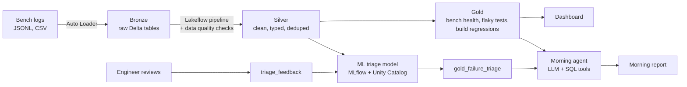

# Nightshift

Morning triage for hardware test labs, built on Databricks.

Hardware test benches run long suites overnight. Every morning, someone has to go through the failures and decide what each one is: a broken test script, a framework bug, a bad cable on the bench, or a real defect in the product. I do this by hand at work, reading logs and screenshots one failure at a time. Nightshift does that sort before anyone gets in.

It ingests raw bench logs, cleans them into a lakehouse, classifies every failure with an ML model, and has an LLM agent write the morning report: what to file as a defect, which bench needs a hardware fix, which scripts to fix, and what it isn't sure about.

> The data is synthetic, modeled on the real benches I work with (single and dual display units, ADB and RS-232 per display, CAN through a Vector box, watchdog reboots). No company data is used.

## Architecture



The whole thing is a Databricks Asset Bundle, so the pipeline, the nightly job and all the notebooks are defined in this repo and deploy with one command.

```
databricks.yml                     bundle config: catalog/schema variables, dev and prod targets
resources/
  nightshift.pipeline.yml          Lakeflow pipeline for silver and gold
  nightshift.job.yml               nightly job that runs the whole chain
src/
  00_setup.py                      schema, raw_logs volume, feedback table
  01_generate_logs.py              synthetic bench logs with three planted problems
  02_bronze_ingest.py              Auto Loader into bronze
  pipelines/silver.sql             dedupe, fix timestamps, join bench and build, data quality
  pipelines/gold.sql               bench health, flaky tests, build regressions
  checks/check_gold_tables.py      asserts the gold tables find what they should
  03_triage_model.py               failure classifier, MLflow, Unity Catalog registry
  04_morning_agent.py              LLM agent with SQL tools, writes the report
  05_triage_feedback.py            review queue and corrections (run by hand)
```

| Step | What it does | Databricks feature |
| --- | --- | --- |
| `00_setup` | Creates the schema, the raw file volume and the feedback table | Unity Catalog |
| `01_generate_logs` | 30 nights of logs for 15 benches, with three planted problems | Unity Catalog volume |
| `02_bronze_ingest` | Loads new log files incrementally, keeps everything as strings | Auto Loader, Delta |
| `pipelines/silver.sql` | Dedupes, fixes mixed timestamp formats, joins bench and build info | Lakeflow Declarative Pipelines, expectations |
| `pipelines/gold.sql` | Bench health per night, flaky test detection, build regressions | Materialized views |
| `checks/check_gold_tables` | Fails the job if the gold tables stop finding the planted problems | Lakeflow Jobs |
| `03_triage_model` | Classifies each failure as script, framework, hardware or real defect | scikit-learn, MLflow, Unity Catalog models |
| `04_morning_agent` | Investigates last night with SQL tools and writes the report | Unity Gateway (Llama 3.3 70B), MLflow tracing |
| `05_triage_feedback` | Review queue for low-confidence calls; corrections become training labels | Delta, parameterized SQL |
| Dashboard | Last night at a glance, bench health heatmap, reboots, flaky tests, regressions | AI/BI dashboards |

## How I approached it

### Start from the real problem

The morning sort is the slowest, most repetitive part of my job, and the call is almost always one of four things: script, framework, hardware, or real defect. Each one goes to a different team. So the project is built around that one decision, and everything else (the lakehouse, the dashboard, the agent) exists to make that call faster and more trustworthy.

### Make the data look like a real lab

I couldn't use real data, so I wrote a generator based on how my benches actually work: single and dual display units, a PCM link over Molex or BroadR-Reach, smoke (~40 min), sanity (~90 min), bootup, and dm and coverage runs on some nights. Failures follow the real mix: mostly broken scripts, then framework bugs, then ADB and hardware, and only about 10% real defects. The watchdog reboots a bench after repeated ADB errors, like it does at work.

The bench names went through a couple of rounds. Themed names looked nice but you couldn't tell anything from them, so they're now just `SOLO-01` (one display) and `DUO-01` (two). The display count is the first thing you need when reading a failure; everything else about the bench is a column.

I also made the logs messy on purpose, because real ones are. Three older bench PCs log epoch timestamps instead of ISO, about 1% of lines are duplicated by uploader retries, and 10% of failures have no error message at all. A pipeline that only works on clean data doesn't prove much.

### Plant problems, then try to find them

The generator hides three problems, and the real cause of every failure goes only into a separate answer key that the pipeline never reads. The point is to find them the way you would at work, without being told.

1. **A failing cable.** DUO-03's ADB cable on display 2 starts degrading on day 18. Failures and watchdog reboots climb every night after that.
2. **A flaky test.** `brightness_slider` fails about 15% of the time on every bench and every build.
3. **A bad build.** `v2.4.1` makes cold boot too slow, but only on dual-display benches.

Each one maps to a gold table, and each one shows up on the dashboard:

- `gold_bench_nightly_health`: DUO-03 holds 96 to 98% until mid-October, then drops to 85% with 4 to 5 reboots a night.
- `gold_test_flakiness` flags exactly one test: `brightness_slider`, intermittent on all 7 builds.
- `gold_build_regressions` returns exactly one row: v2.4.1, `cold_boot_time`, dual display, 56 of 56 runs failed.

### Bronze keeps everything, silver fixes it

Bronze stores every column as a string, exactly as written, plus the source file and load time. If Spark inferred types, it would have to pick between the epoch and ISO timestamp formats and quietly null out the other. Keeping bronze raw means silver can always be rebuilt from it if a cleaning rule turns out to be wrong.

Auto Loader loads the run logs because each night adds new files, and it only picks up the new ones. The small reference files (benches, builds) are plain overwrites.

Silver and gold are a Lakeflow pipeline in SQL. Silver drops rows with an invalid status or no timestamp, since those can't count toward a pass rate, but only warns on failures with no error message: those are still real failures, and the model has to deal with them.

### Getting the gold rules right

The flaky test rule is the one I iterated on most. The first version flagged any test with an 8 to 50% fail rate, and that caught about 40 tests that just had a couple of random failures. Flaky really means "fails sometimes, on every build", so the rule now requires that pattern on at least 4 different builds. That cut it to the one test that's actually flaky, and it also stops a single bad build from looking like flakiness.

Regressions are the opposite pattern: a test that fails on most runs of one build. They're split by display count, because averaged together, a build that breaks only dual-display benches would look half broken everywhere instead of fully broken where it matters.

### Triage model

Each failure gets the features an engineer would actually look at:

- the error message text (TF-IDF)
- status, suite, test, display, bench type
- how many other tests failed in the same run (a bad bench fails a lot of tests)
- whether the watchdog rebooted that run
- what share of benches failed this test on this build (a bad build fails everywhere)
- how often this test fails overall (flaky tests fail a little, everywhere)

It's a logistic regression. With about 2,000 labeled failures, a linear model trains in seconds, is hard to overfit, and its weights show what drives each call. The interesting signal is in the context features, not in model size. Classes are balanced so the model can't ignore real defects, the rarest class and the one that matters most.

The model is trained on older nights and tested on the most recent 8, the same way it would be used: predict this morning from what happened before. A random split would let it learn from the future.

| Metric | Result |
| --- | --- |
| Accuracy | 96% |
| Macro F1 | 0.94 |
| Accuracy when the error message is missing | 67% |

Macro F1 is there because accuracy alone looks good just by getting script failures right. The missing-message number is the honest one: with no text, the model still gets two thirds right from context alone. Anything below 0.7 confidence goes to a "needs a human look" list instead of being reported as fact.

### Feedback loop

The model is only as good as its labels. `05_triage_feedback` gives engineers a review queue of last night's low-confidence calls and a one-line way to record the real cause. Only low-confidence calls are queued, because reviewing everything would just be the manual triage again. Corrections land in `triage_feedback`, and `03_triage_model` trains on them first, falling back to historical labels for everything else. MLflow logs how many human-reviewed labels each training run used, and the notebook shows how often engineers overrode the model and in which direction.

With synthetic data, the "engineer" is simulated from the answer key, so the loop shows the mechanics rather than an accuracy gain. In a real lab, this is where the model would actually get better: every morning's reviews become the next night's training data.

### Morning agent

The agent has a few read-only SQL tools over the gold tables: a triage summary, failures by bench or category, a bench's 14-night history, and known flaky tests and regressions. It runs on a Databricks-hosted model through Unity Gateway, and every LLM and tool call is traced in MLflow. Anything the model passes to a tool goes in as a SQL parameter, never pasted into the query.

What I learned building it: the first versions listed every failure one by one and filed a 53%-confidence guess as a defect. Switching from Llama 3.3 70B to gpt-oss-120b produced nearly the same report, so the model wasn't the problem. The fix was moving the analysis into SQL (trend vs. the previous 7 nights, known flaky tests, how many benches share a failure) and letting the LLM do the writing. After that, the report leads with what matters:

> DUO-03 is at 85% pass rate vs. 93% over the previous 7 nights, with 4 reboots last night. 16 ADB failures point to a cable or adapter problem.

### Packaging it

I built everything interactively first, then moved it into an Asset Bundle so it's reproducible: catalog and schema are variables instead of hardcoded, the pipeline and job are YAML in the repo, and a data check runs between the pipeline and the model so a broken gold rule stops the job instead of feeding bad data to the agent.

## Why Databricks

- One place for raw logs, clean tables, the model and the agent, with lineage through Unity Catalog.
- Auto Loader and Lakeflow handle the messy parts (new files every night, mixed formats, duplicates, data quality checks) without custom plumbing.
- The model registry and MLflow tracing make the ML and the agent auditable, which matters when a report tells someone to file a defect.
- It scales to a real lab: hundreds of benches and months of history is the same code.

**Tradeoffs.** For a single lab with 15 benches, this is more platform than the data needs; Postgres and Grafana would cover the dashboard. Serverless startup time also adds a minute or two to each run. The payoff is in the ML and agent layers and in scaling to many labs, where keeping everything governed in one place starts to matter.

## Running it

Works on Databricks Free Edition.

**With the Databricks CLI (recommended)**

```bash
databricks auth login --host https://<your-workspace>.cloud.databricks.com
databricks bundle validate
databricks bundle deploy
databricks bundle run nightshift_nightly
```

That deploys the notebooks, creates the pipeline and the job, and runs everything from setup to the morning report. The job's 6 AM schedule ships paused. To use a different catalog or schema, pass `--var="schema=nightshift_dev"`.

**From a Git folder, by hand**

1. Clone this repo as a Git folder.
2. Run `src/00_setup`, `src/01_generate_logs`, then `src/02_bronze_ingest`.
3. Create a Lakeflow pipeline from `src/pipelines/silver.sql` and `src/pipelines/gold.sql`, with catalog `workspace` and schema `nightshift`, and run it.
4. Run `src/checks/check_gold_tables`, `src/03_triage_model`, then `src/04_morning_agent`.
5. Optional: run `src/05_triage_feedback` with `simulate_reviews` set to `true`, then rerun `03_triage_model` to retrain on the corrections.

## What's next

- Put the dashboard in the bundle so it deploys with everything else.
- Give the agent the Databricks-managed SQL and Genie MCP servers instead of hand-written tools.
- Add screenshot analysis for failures with no error message.
- Post the morning report to Slack or email.
