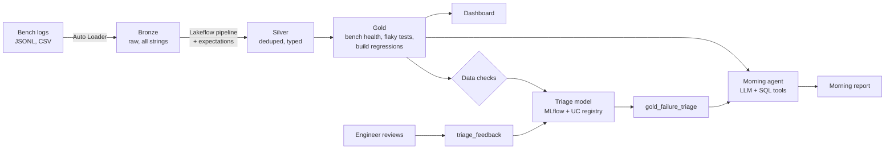

# Nightshift

Morning triage for hardware test labs, built on Databricks.

**Demo site:** https://rpuranikx.github.io/nightshift/

In my lab, benches run test suites overnight. Every morning we spend the first hours of the day going through the failures one by one, reading logs and screenshots, and deciding whether each one is a real defect or noise before we can write anything up. Nightshift does that analysis before anyone gets in, so writing the report takes minutes and the early-morning brainpower goes to the failures that actually matter.

It loads raw bench logs into a lakehouse, cleans them, sorts every failure into script, framework, hardware or real defect with an ML model, and has an LLM agent write the morning report.

> The data is synthetic, modeled on the benches I work with. No company data is used.

## The problem

Every failure on a bench is one of four things, and each one goes to a different place:

| Cause | Example | Who handles it |
| --- | --- | --- |
| Script | Test looks for a button that moved | Test team fixes the script |
| Framework | Harness loses its session mid-run | Framework team |
| Hardware | ADB cable going bad on one bench | Lab, swap the cable |
| Real defect | Display doesn't change brightness | Dev team, file a defect |

Most failures are scripts. Real defects are the smallest group and the one that matters most. Sorting them is slow, repetitive, and the same reasoning every morning, which makes it a good thing to automate.

## The data

The generator simulates 15 benches over 30 nights. Benches are `SOLO-01..08` (one display) and `DUO-01..07` (two displays), each with ADB and RS-232 per display and a PCM link over Molex or BroadR-Reach. Suites run like they do at work: smoke (~40 min), sanity (~90 min) and bootup every night, with dm and coverage on some nights. When a bench hits repeated ADB errors, the watchdog reboots it.

The logs are messy on purpose, because real ones are: three older bench PCs log epoch timestamps instead of ISO, about 1% of lines are duplicated by uploader retries, and 10% of failures have no error message at all.

Three problems are hidden in the data. The true cause of every failure goes only into a separate answer key that the pipeline never reads, so the gold tables have to find them on their own:

1. **A failing cable.** DUO-03's ADB cable on display 2 starts degrading on day 18. Failures and reboots climb every night after.
2. **A flaky test.** `brightness_slider` fails about 15% of the time on every bench and every build.
3. **A bad build.** `v2.4.1` makes cold boot too slow, but only on dual-display benches.

## Architecture



The project is a Databricks Asset Bundle. The pipeline, the job and the notebooks are all defined in this repo, and one job runs the whole chain:

```
setup → generate_logs → bronze_ingest → silver_gold (pipeline) → check_gold → triage_model → morning_agent
```

```
databricks.yml                     bundle config, catalog/schema variables
resources/
  nightshift.job.yml               the job above
  nightshift.pipeline.yml          Lakeflow pipeline for silver and gold
src/
  00_setup.py                      schema, raw_logs volume, feedback table
  01_generate_logs.py              synthetic bench logs
  02_bronze_ingest.py              Auto Loader into bronze
  pipelines/silver.sql             cleaning and data quality
  pipelines/gold.sql               bench health, flaky tests, regressions
  checks/check_gold_tables.py      stops the job if gold stops finding the planted problems
  03_triage_model.py               failure classifier
  04_morning_agent.py              the agent
  05_triage_feedback.py            review queue for engineers (run by hand)
```

## Decisions

**Bronze keeps everything as strings.** Benches log timestamps in two formats. If Spark inferred types, it would pick one and silently null out the other. Bronze stores the text exactly as written, and silver decides how to parse it, so silver can always be rebuilt if a cleaning rule turns out wrong.

**Auto Loader for the logs.** Every night adds new files. Auto Loader remembers which files it already loaded, so each run only reads the new ones, and rerunning the job never duplicates data.

**Silver drops what can't be counted, but keeps failures with no message.** A result with no status or timestamp can't go toward a pass rate, so it's dropped. A failure with no error message is still a real failure, so it only gets flagged, and the model has to cope with it.

**Flaky means "fails sometimes, on every build."** My first rule flagged any test with an 8 to 50% fail rate, and it caught about 40 tests that just had a couple of random failures. Requiring that pattern on at least 4 different builds cut it to the one test that's actually flaky, and it keeps a single bad build from looking flaky.

**Regressions are split by display count.** Averaged together, a build that only breaks dual-display benches looks half broken everywhere instead of fully broken where it matters.

**Data checks between the pipeline and the model.** The data is generated with a fixed seed, so the gold tables should find exactly the three planted problems. If a SQL change breaks that, the job stops before the model and the agent run on bad data.

## Triage model

The model looks at each failure and predicts which of the four causes it is, plus how confident it is.

Most of the time the error message gives it away, but not always. 10% of failures have no message, and the same message can mean different things in different places. So the model also looks at what an engineer would check: how many other tests failed in the same run (a bad bench fails a lot), whether the watchdog rebooted it, what share of benches failed this test on this build (a bad build fails everywhere), and how often this test fails in general (a flaky script fails a little, everywhere).

It's a logistic regression on the error text plus those context features. With about 2,000 labeled failures, a simple model trains in seconds, is hard to overfit, and its weights show what's driving each call. It's trained on older nights and tested on the most recent 8, the same way it's used: predict this morning from what happened before.

| Metric | Result |
| --- | --- |
| Accuracy | 96.6% |
| Macro F1 | 0.95 |
| Accuracy when the error message is missing | 72% |
| Real defect recall | 0.89 |

Macro F1 is there because accuracy alone looks good just by getting scripts right. Real defect recall is the number I'd watch: about 1 in 10 real defects gets called something else. That's why anything below 0.7 confidence goes to a person instead of the report, and why the feedback loop exists.

**Why not have the LLM classify every failure?** A real lab has thousands of failures a night. The model scores all of them in seconds for free, gives the same answer every time, and has an accuracy I can measure. The LLM is better spent on what it's good at: reading the results and writing the report.

## Feedback loop

`05_triage_feedback` gives engineers a review queue of last night's low-confidence calls and a one-line way to record the real cause. Only low-confidence calls are queued, since reviewing everything would just be the manual triage again. Corrections go into `triage_feedback`, and the model trains on them first the next time it runs. MLflow logs how many human-reviewed labels each training run used.

With synthetic data the "engineer" is simulated from the answer key, so this shows the mechanics rather than a real accuracy gain. In a real lab, this is where the model actually gets better over time.

## Morning agent

The agent has a few read-only SQL tools over the gold tables and runs on Llama 3.3 70B through Unity Gateway. Every model call and tool call is traced in MLflow, so when the report says "file a defect", you can see exactly which query results it was based on.

Getting the report right took a few rounds, and every round taught me the same lesson:

1. **The first version** got raw failures and listed every one of them, and it filed a 53%-confidence guess as a defect. Switching to gpt-oss-120b gave nearly the same report, so the model wasn't the problem.
2. **I moved the analysis into SQL.** Trends against the previous 7 nights, known flaky tests, and how many benches share a failure became columns in one summary tool. The report started leading with the DUO-03 cable, which is what an engineer would want first.
3. **It still ignored rules in the prompt.** One-off defects kept landing in "File a defect" even though the prompt said to watch them, and it started reading the rules back in the report ("action is 'watch', not 'act'...").
4. **So SQL now decides which section every failure goes in**, and the prompt just says to write it up without moving anything. That fixed it.

Before:

> **File a defect**
> - DUO-03: 2 real_defect failures on tests "sanity_nav_03" and "sanity_serial_06"...
> - SOLO-06: 1 real_defect failure on test "sanity_can_06"...

After:

> **Watch**
> - DUO-03: 2 real defect failures, including "sanity_nav_03" and "sanity_serial_06"...
> - SOLO-06: 1 real defect failure, test "sanity_can_06"...

The takeaway: if a rule can be written in SQL, put it in SQL. Let the LLM do the writing, not the deciding.

## Why Databricks

**Couldn't this just be a Jupyter notebook?** For the analysis, yes. 64,000 log lines fit in pandas on a laptop, and I could have found all three planted problems in an afternoon that way. But finding them once isn't the job. The job is a report waiting every morning, from logs that keep arriving, that people can trust and act on. That's where a notebook on my laptop stops working:

- **It has to run every night without me.** A notebook runs when I open it. Here, one job runs ingest, cleaning, checks, the model and the agent, in order, and if a step fails, it stops there and can be rerun from that step.
- **New logs arrive every night.** A notebook rereads every file every time, or I write my own "what have I already loaded" logic. Auto Loader does that for me, so a rerun never duplicates data.
- **Bad data shouldn't reach the report quietly.** Pipeline expectations count and drop bad rows on every run, and the gold checks stop the job before the model and agent see broken tables. In a notebook those checks only happen if I remember to run them.
- **Other people need the results, not my notebook.** The gold tables sit in Unity Catalog. A lab lead can open the dashboard, an engineer can query a table, and permissions and lineage come with it, back to the raw file each row came from.
- **The model and the agent have to be auditable.** Every training run is logged in MLflow with its metrics and data, every model version is registered, and every agent report is traced down to the queries it ran. When the report says "file a defect", I can show exactly why. A notebook gives me a model in memory and a printout.
- **It has to be reproducible.** The whole project is an Asset Bundle. `databricks bundle deploy` sets it up in any workspace, the same way every time, from code in git.
- **It has to grow.** One lab with 15 benches is small. Several labs with hundreds of benches and a year of history is the same code here. In pandas it's a rewrite.

So the notebook answers "what went wrong last month?" Databricks answers "what went wrong last night?" every morning, without me in the loop.

**Tradeoffs.**

- For one lab with 15 benches, this is more platform than the data needs. Postgres and Grafana would cover the dashboard.
- Serverless startup adds a minute or two to each step, so the whole job takes about 10 minutes for data that would fit on a laptop.
- There's more to learn and set up than a notebook: bundles, pipelines, Unity Catalog permissions.
- The LLM call costs money and adds a little nondeterminism. That's why the analysis is in SQL and every report is saved with its trace.
- The payoff is in running it every day, the ML and agent layers, and scaling to many labs, where keeping everything governed in one place starts to matter.

## Run it yourself

Works on Databricks Free Edition.

```bash
databricks auth login --host https://<your-workspace>.cloud.databricks.com
databricks bundle deploy
databricks bundle run nightshift_nightly
```

## What's next

- A plug-in-your-own-data mode: a documented input format, a demo flag that turns off the generator, and training on engineer reviews only.
- Trigger the job when new log files arrive instead of on a schedule.
- A demo site with a walkthrough of the decisions and a recording of the agent.
